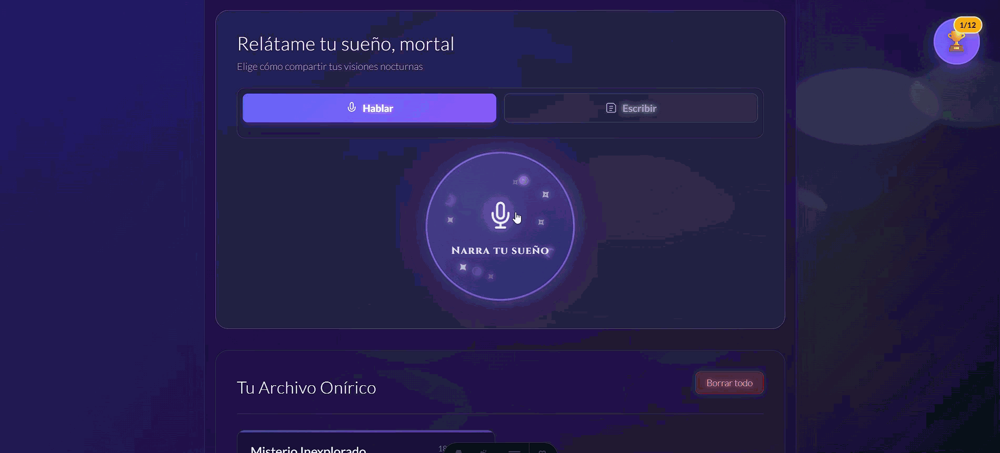
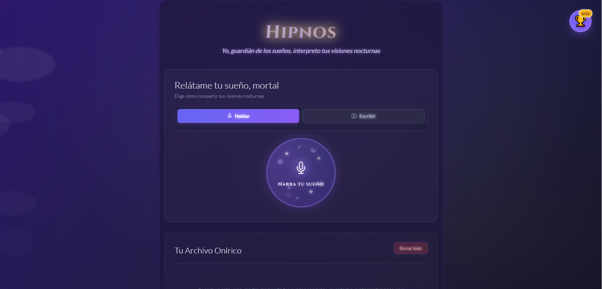
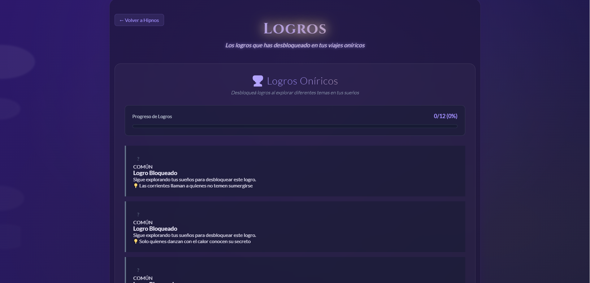

# Hipnos

**Hipnos** es una aplicación web artística e interactiva para explorar e interpretar sueños. Inspirada en el dios griego del sueño, esta aplicación te permite narrar tus visiones nocturnas y recibir interpretaciones místicas basadas en simbolismos antiguos.


**[Ver Aplicación en Vivo](https://hipnos.netlify.app/)**

## Capturas de Pantalla

<div align="center">
  
  <p><em>Flujo completo: narras tu sueño, recibes la interpretación y desbloqueas un logro</em></p>

  
  <p><em>Interfaz principal para interpretar sueños</em></p>
  
  
  <p><em>Sistema de logros y colección de arquetipos</em></p>
</div>

## Características

- ** Reconocimiento de Voz**: Narra tus sueños usando tu voz con integración de Deepgram y Web Speech API
- ** Interpretación de Sueños**: Análisis automático basado en palabras clave y simbolismos
- ** Archivo de Sueños**: Guarda y revisa tus interpretaciones anteriores
- ** Sistema de Logros**: Desbloquea logros mientras exploras diferentes arquetipos oníricos
- ** Interfaz Mística**: Diseño inmersivo con animaciones de nubes y efectos de niebla
- ** Diseño Responsivo**: Experiencia optimizada para dispositivos móviles y desktop

## Instalación y ejecución local

### Requisitos

- **Node.js 18.14.1 o superior** (recomendado: 20 LTS)
- **npm** (incluido con Node.js)
- **Netlify CLI** (opcional, solo para probar la búsqueda de voz de Deepgram en local)

### 1. Clonar el repositorio

```bash
git clone https://github.com/FrancoRigante01/Hipnos.git
cd Hipnos
```

### 2. Instalar dependencias

```bash
npm install
```

### 3. Configurar variables de entorno (opcional)

Crea un archivo `.env` en la raíz del proyecto:

```env
DEEPGRAM_API_KEY=tu_api_key
```

La clave es **opcional**: sin ella la interpretación por texto y el reconocimiento de voz del navegador (Chrome, Edge) funcionan igual. Deepgram se usa en Firefox y en dispositivos móviles. La clave se usa solo en el servidor (función de Netlify) y nunca se envía al navegador. No la subas al repositorio: `.env` ya está en `.gitignore`.

### 4. Levantar la aplicación

Hay dos formas:

**Desarrollo rápido** (interpretación por texto y voz del navegador):

```bash
npm run dev
```

Abre `http://localhost:4321` en el navegador.

**Entorno completo con Netlify** (incluye la función que genera tokens de Deepgram):

```bash
npx netlify dev
```

Abre la URL que muestra la consola (por defecto `http://localhost:8888`). Este modo lee el `.env` automáticamente.

> `npm run dev` no ejecuta las funciones de Netlify, así que el reconocimiento de voz con Deepgram no funcionará en ese modo.

### Otros comandos

```bash
npm run build     # Genera la versión de producción en dist/
npm run preview   # Sirve el build generado localmente
```

## Uso

### Interpretación de Sueños

1. **Escribe o narra** tu sueño en el campo de texto o usando el botón de voz
2. Haz clic en **"Interpretar Sueño"**
3. Recibe una interpretación basada en los símbolos detectados
4. Tu sueño se guardará automáticamente en tu archivo personal

### Sistema de Logros

- Los logros se desbloquean automáticamente al interpretar sueños con ciertos símbolos
- Visita la página de **"Logros"** para ver tu progreso
- Cada logro tiene diferentes categorías temáticas (agua, fuego, animales, etc.)|   

## Tecnologías Utilizadas

- **[Astro](https://astro.build/)** - Framework web moderno
- **[Deepgram SDK](https://deepgram.com/)** - Reconocimiento de voz
- **Web Speech API** - Reconocimiento de voz del navegador
- **Vanilla JavaScript** - Lógica de la aplicación
- **LocalStorage** - Persistencia de datos
- **CSS3** - Animaciones y estilos personalizados

## Decisiones Técnicas

### ¿Por qué Deepgram?

El reconocimiento de voz del navegador (Web Speech API) funciona bien en Chrome y Edge, pero no es uniforme en el resto de los entornos: Firefox no la soporta y en móviles el comportamiento varía entre iOS y Android. Para que la narración de sueños funcione igual en todos los dispositivos, Hipnos usa un esquema híbrido:

| Entorno | Motor de reconocimiento |
|---|---|
| Chrome / Edge (escritorio) | Web Speech API del navegador, sin dependencias externas |
| Firefox y dispositivos móviles | Deepgram (streaming por WebSocket, modelo `nova-2` en español) |
| Navegador sin Web Speech API | Deepgram como fallback |

## Autor

**Franco Rigante**

- GitHub: [@FrancoRigante01](https://github.com/FrancoRigante01)

---

*"Yo, guardián de los sueños, interpreto tus visiones nocturnas"*
